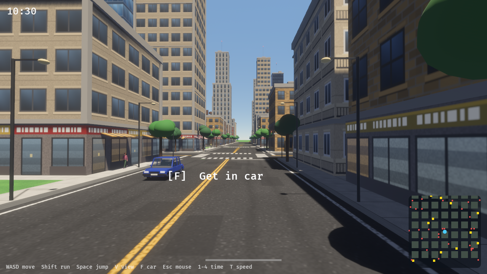
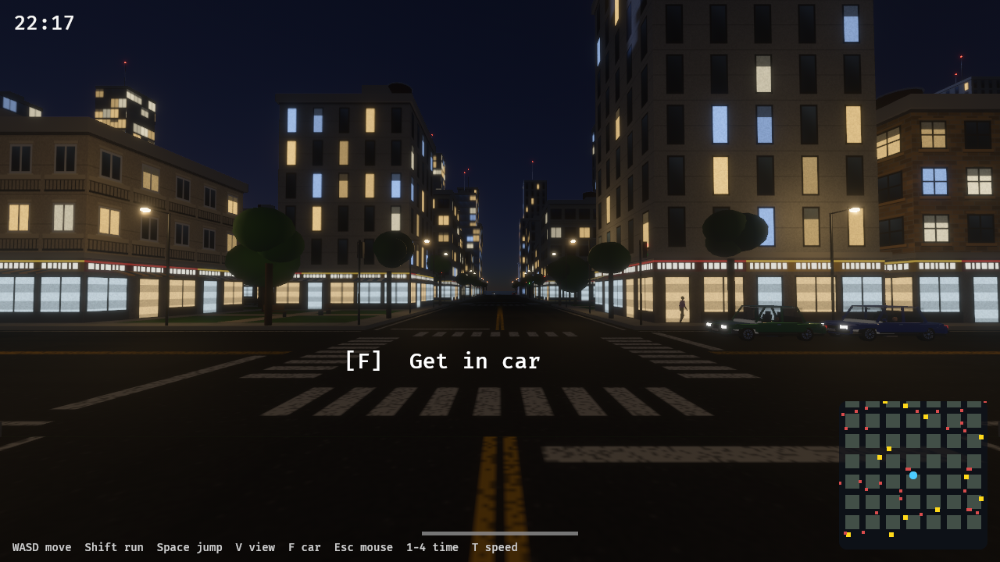

# City Sandbox

A small open-world city you can walk and drive around, written in Rust with [Bevy](https://bevy.org) 0.16. Everything (textures, meshes, sounds) is generated in code, so there are no asset files.



## Features
- **First-person or third-person** view, with mouse look, head bob, jumping and sprinting
- **A real-looking person**: jointed body, detailed face, and a walk/run cycle that matches your speed
- **Cars with physics**: spinning and steering wheels, grip, handbrake drifting, weight transfer, collisions, and a cockpit view
- **A living city**: textured buildings, storefronts, traffic that obeys signals, and pedestrians
- **Day and night**: a procedural sky, lit windows and street lamps
- **Procedural audio**: engine, tires, horn and footsteps



## Run it
You need [Rust](https://rustup.rs). Then:

```
cargo run
```

## Controls
| Key | Action |
| --- | --- |
| W A S D | Move / drive |
| Mouse | Look |
| Shift | Sprint |
| Space | Jump (on foot) / handbrake (in car) |
| F | Get in / out of a car |
| H | Horn |
| V | First / third person |
| 1-4 | Set time of day |
| T | Change time speed |
| Esc | Release the mouse |

## Screenshot mode
`CITY_SHOT=1 cargo run` plays a scripted tour (it even drives and runs) and saves PNGs, which is handy for checking changes without playing.
